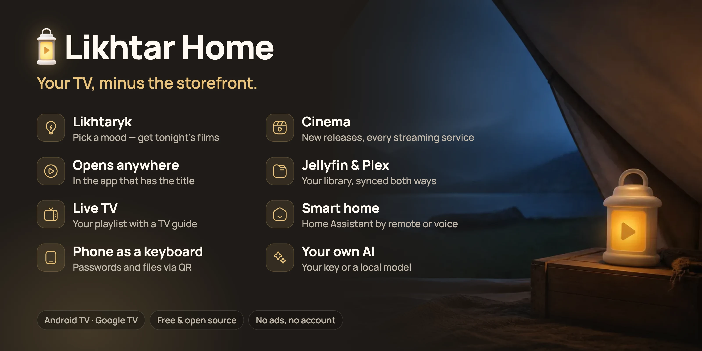
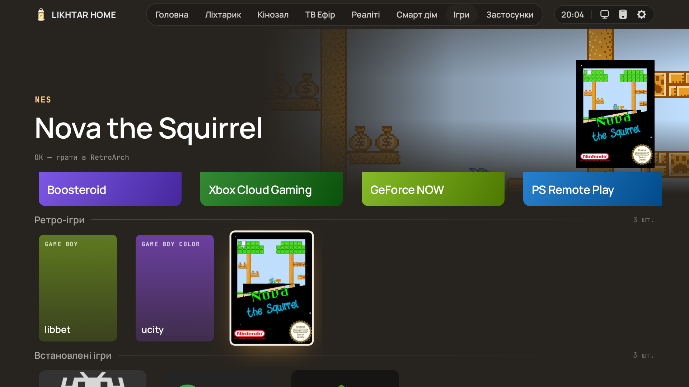

<div align="center">

**English** · [Українська](README.uk.md)

# Likhtar Home

**Films first. Apps second.**

A home screen for Android TV and Google TV that answers one question — *what are we watching tonight?*
Turn on the TV, pick a mood, press OK.

| Stock Google TV | Likhtar Home |
|:---:|:---:|
|  |  |
| *A sponsored banner, rows picked for you* | *Your wallpaper, the time, and your sections in the dock* |

### [Install from your phone](https://github.com/Syvyj/likhtar-home/releases/latest/download/likhtar-installer.apk) &nbsp;·&nbsp; [Download the TV app](https://github.com/Syvyj/likhtar-home/releases/latest/download/likhtar-home.apk)

<sub>Phone: a small Android app finds the TV on your Wi‑Fi and installs Likhtar. TV: the APK for Downloader, a USB stick or <code>adb install</code>. <a href="#install">How to install</a></sub>

[](https://github.com/Syvyj/likhtar-home/releases/latest) `Android TV / Google TV` · `Android 7.0+` · `6.4 MB` · `GPL-3.0`

**No ads · no tracking · no account · no root · no computer needed · one button to undo**



</div>

## Why Likhtar?

Stock TV home screens are storefronts. They are built to sell you the next subscription, so the
thing you actually want — *something good to watch, right now* — is buried under ads, autoplaying
trailers and rows you never asked for. *Likhtar* means "lantern" in Ukrainian: a warm, quiet light in
the corner of the living room that shows you the way to tonight's film and then gets out of the way.
It is not just another grid of app icons.

### A calm home screen

Your wallpaper, the clock and your sections in the dock; everything else is one press away. Warm
graphite and amber, big type, no autoplay noise. Every screen is built for a D‑pad from the sofa:
focus never gets lost, rows never jump.

### Something to watch tonight

**Likhtaryk** picks films and series by format and mood, skipping what you've already seen.
**Cinema** shows what's new in your country and a page for every streaming service. A title opens
where it lives — Netflix in Netflix, YouTube in YouTube — and Likhtar never plays or hosts pirated
streams. Want to ask in your own words? [Connect your own AI](#ai-on-your-terms-optional), if you like.

### Set up your TV from your phone

A small Android app finds the TV on your Wi‑Fi and installs Likhtar, no computer or USB stick. After
that, scan a QR code to reorder sections, choose which Cinema rows and streaming services show,
type passwords and playlist addresses, and send files. Nothing is typed with the remote.

### Everything else in one place

Your **Jellyfin** and **Plex** libraries with *Continue watching* synced both ways, **Live TV** from your
own M3U playlist with a programme guide, **Home Assistant** rooms by remote or voice, **games** from
the cloud and your own ROMs, and your apps sorted for you.

## See it in action

| | |
|---|---|
|  | **Likhtaryk — the advisor.** Choose a format (film, series, anime, cartoon, documentary, reality) and a mood (light, funny, tense, mysterious, romantic, smart…) and get a selection of films and series for tonight — skipping what you've already watched. |
|  | **Cinema.** A full-screen spotlight on what's new and trending, then rows of popular films and series for your country, genres, and a page for every streaming service — with what just landed there. |
|  | **Title pages that help you decide.** Where to watch it, episodes with stills, trailers, cast, similar titles and the whole franchise in order. Tabs switch as you move — no extra clicks. |
|  | **Live TV from your own playlist.** Paste your provider's M3U and XMLTV once (from your phone), get a channel grid with logos, groups and what's on now. |
|  | **Reality.** The shows everyone talks about, gathered in one shelf instead of scattered across five apps. |
|  | **Smart home, from the sofa.** Your Home Assistant rooms and devices on the big screen: lights, blinds, the air conditioner, the kettle, scenes like *Movie night*. Toggle them with the remote, or just say what you want — the request goes to your own Home Assistant Assist. |
|  | **Send anything from your phone.** Scan the QR code and drop a video, a photo, an APK or a link onto the TV — no app, no cable, no cloud. Even a full-length film goes straight to the TV's Downloads and opens in the right player or installer. |
|  | **Games, in their own section.** Cloud gaming (Boosteroid, Xbox Cloud Gaming, GeForce NOW, PS Remote Play) in one press, and your own ROMs with box art, started in RetroArch with no menus. Off by default; details in [docs/games.md](docs/games.md). |
|  | **Your apps, sorted for you.** Grouped automatically, with what's new inside each service shown right on the tile. Hide, pin or lock any app with a PIN. |
|  | **Settings from your phone.** Scan a QR code: type passwords and addresses on the phone, reorder sections, choose Cinema rows and streaming services, paste text into the TV's clipboard. |

Also inside: a **media library** for your **Jellyfin** and **Plex** servers (Continue watching and
watched marks stay in sync both ways), DLNA servers and SMB shares, weather on the home
screen, idle-mode wallpapers, profiles with PIN locks, and remote-key remapping.

## Install

### From your phone (easiest)

1. On the TV: *Settings → System → About*, press OK on *Android TV OS build* seven times. Then in
   *Developer options* turn on *USB debugging* (on some TVs it's called *Network debugging*).
2. On an Android phone on the same Wi-Fi, install [**Likhtar Installer**](https://github.com/Syvyj/likhtar-home/releases/latest/download/likhtar-installer.apk).
   Press *Find the TV*, then *Install*, and allow debugging when the TV asks.
3. Likhtar opens on the TV and offers to become your home screen. That's it.

TVs that only allow wireless debugging with pairing are not supported by the installer yet; use the
classic way.

### Or the classic way

1. Download [**likhtar-home.apk**](https://github.com/Syvyj/likhtar-home/releases/latest/download/likhtar-home.apk) and install it with the *Downloader* app, from
   a USB stick, or with `adb install likhtar-home.apk`.
2. Open Likhtar Home and follow the prompt to make it your home screen. Google TV tries hard to
   keep its own launcher, so Likhtar walks you through a one-time setup on the TV itself — no
   computer needed.

| You want to… | Do this |
|---|---|
| Just try it | Install it and open it like any app. Nothing on the TV changes. |
| Make it your home screen | Press *Make Likhtar your home screen* inside the app. One confirmation on the TV, no computer. |
| Go back to stock | *Settings → Remote and startup → Bring back the stock home screen.* One button. |

Requires Android TV or Google TV 7.0 or newer; the UI is laid out for 1080p and scales to 720p and
4K. The devices we have tested are [listed below](#tested-on). How a TV lets another app become the
home screen differs between manufacturers, so the switch can behave differently on yours.

## Safe to try, easy to undo

Becoming the home screen on Google TV is the scary part, so here is exactly what happens.

- **Nothing is uninstalled.** Likhtar sets itself as the home activity and *disables* — not removes —
  the stock Google TV launcher and its setup wizard. Nothing else is touched.
- **It talks to the TV, not to the internet.** The switch uses the TV's own debugging connection
  (`127.0.0.1`), so no computer and no cable are needed. You approve it once on screen.
- **Your Wi-Fi is checked first.** If a saved network belongs to an app that would be disabled, Likhtar
  refuses to continue — disabling it could forget your Wi-Fi.
- **One button back.** *Settings → Remote and startup → Bring back the stock home screen* re-enables
  everything in the reverse order.
- **A crash safety net.** If Likhtar crashes three times within five minutes, it tries to give the
  home screen back to the stock launcher by itself. It covers the usual crash loop, not every
  possible failure, so the button above is still the way back.

> ⚠️ **Before uninstalling Likhtar, press *Bring back the stock home screen* first.** Android gives an
> app no chance to undo its changes while it is being removed.

### Uninstalled it and got a black screen?

Nothing is broken: the stock home screen is only switched off, so the TV has no home screen to show.
Switch it back on in any of these ways:

<details>
<summary><b>Show the three ways back</b></summary>


1. **Without a computer.** Open the TV settings — say *"Open settings"* to the Assistant (the
   microphone button), or press the ⚙ Settings button if your remote has one. Go to *Apps → See all
   apps → Show system apps*, open **Google TV Home** and **Google TV Setup** (names vary a little
   between brands) and press **Enable** on each. Then press HOME or restart the TV.
2. **From a computer** on the same network — USB debugging is still on:
   ```bash
   adb connect <TV address>:5555
   adb shell pm enable com.google.android.tungsten.setupwraith
   adb shell pm enable com.google.android.apps.tv.launcherx
   ```
   Accept the debugging prompt on the TV if it appears.
3. **Or put Likhtar back** (`adb install likhtar-home.apk`), open it, press *Bring back the stock home
   screen*, and only then uninstall it.

</details>

## Privacy, in plain words

- Your history, lists, profiles, PINs and settings stay on the TV.
- Keys, tokens, passwords and playlist addresses are stored encrypted.
- Film data comes from TMDB through a small read-only Likhtar gateway, so there is no API key to
  paste. Like any website it sees your IP address, the titles and searches being looked up — but
  not your history, your lists, your settings or anything you ask the AI. Normal requests are not logged.
- Full details: [docs/privacy-policy.md](docs/privacy-policy.md).

## AI, on your terms (optional)

Connect an AI model and just say what you're in the mood for: *"something like Interstellar, but
lighter"*, *"a cosy series for a rainy weekend"*, *"what to watch with a seven-year-old"*. Likhtaryk
answers with a pick, a sentence on why, and a row of alternatives.

**An AI film advisor that works in any country, needs no Google account, and runs on the model you
choose** — in your language, on any TV or box with Android TV, not just the latest TVs in a few markets.

- **Your key, your model.** Use your own API key for **Anthropic Claude, OpenAI, Google Gemini or
  OpenRouter** — or point Likhtar at a model running on your own computer (**Ollama, LM Studio**),
  free and fully private.
- **Typed on your phone**, scanned in by QR, stored on the TV encrypted with a key from the Android
  Keystore that never leaves the device.
- **Straight to the provider.** Your request goes directly to the AI provider you choose. Likhtar's
  server doesn't receive it.
- **We check every title.** Each suggestion is matched against TMDB by title and year before it is
  shown, so a film the model made up doesn't reach the screen.
- **Season recaps.** Before season 3, ask for a short retelling of season 2, written from the
  episode summaries — spoilers stop where you are.

Without an AI connected, Likhtaryk still works: format and mood picks come from curated cards,
and search runs on TMDB.

## Questions people ask

**Is it free?** Yes, and open source under GPL-3.0. No ads, no subscriptions, no paid tier.

**Do I need a server or a computer?** No. The public build works on its own; film data comes through a
small read-only gateway. A computer is only needed if you want to sideload with `adb`.

**Does it play films itself?** No. Likhtar shows what is available and where, then opens the official
app — Netflix, Disney+, YouTube, your provider's player. Live TV plays the playlist *you* add.

**Do I need an AI subscription?** No. Mood picks, search and all sections work without AI. Connecting
your own model only adds free-form requests and season recaps — and a local model costs nothing.

**Will Google TV updates break it?** A system update can switch the stock launcher back on. At the
next boot Likhtar quietly takes the home screen back — as long as USB debugging is still on. Your
settings are never touched.

**Do I have to leave USB debugging on?** Only if you want that automatic fix after updates. Turn it
off and Likhtar stays your home screen; after an update you would press *Make it the home screen*
again (Settings → Remote and startup).

**How do I play my own games?** See [docs/games.md](docs/games.md). Likhtar does not include or download any games.

**Which languages?** The interface follows your TV: English, Ukrainian or Polish.

## Tested on

| Device | Android | Status |
|---|---|---|
| Skyworth / RockTek Google TV box (4K) | 14 | Daily use since August 2026 |
| Android Studio Google TV emulator | 14 | Every release |

Tried it on another TV or box? Open an issue with the model and what worked — the list grows with you.

## For developers

Bug reports, device reports, fixes and translations are welcome: see [CONTRIBUTING.md](CONTRIBUTING.md)
and [Issues](https://github.com/Syvyj/likhtar-home/issues).

### Building from source

Requirements: Android Studio (latest stable), JDK 17.

```bash
./gradlew assemblePlayDebug        # public build, debug
./gradlew assemblePlayRelease      # public build, release
./gradlew testPlayDebugUnitTest lintPlayRelease
```

Optional, in a local `.env` (never committed):

```properties
TMDB_key=your-tmdb-api-key            # use TMDB directly instead of the gateway
LIKHTAR_KEYSTORE=/path/to/release.jks # sign release builds with your own key
LIKHTAR_KEYSTORE_PASSWORD=…
LIKHTAR_KEY_ALIAS=…
LIKHTAR_KEY_PASSWORD=…
```

The project is split into `app`, `core/*` (design system, data, catalogue, TV, smart home,
wallpapers) and `feature/*` (one module per screen).

## The story behind Likhtar

Likhtar arrives while everyone is talking about freeing their TV — but it didn't start there, and it
didn't start as a launcher. It grew one annoyance at a time, on a real TV in a real living room.

| When | What happened |
|---|---|
| **Jan 2026** | *Studios Master*: a small plugin for the Lampa media app that gathered TMDB collections from big studios and streamers into its sidebar. Metadata only, about 400 lines of JavaScript. |
| **Mar 2026** | *Likhtar* appears — a custom home page for that app with a hero banner, title logos and badges, focused on Ukrainian-language content. |
| **Aug 5, 2026** | *Likhtaryk*, the film-picking assistant, is born inside the plugin — first running on a local model on a home PC. |
| **Aug 11, 2026** | The plugin hits the limits of someone else's app. First commit of a native Android TV launcher in Kotlin and Compose. |
| **Aug 12, 2026** | Live TV with a real channel grid and TV guide, and the Cinema section on a TMDB catalogue. |
| **Sep 2026** | Reality section, title pages with episodes and franchises, the remote-first focus system rebuilt from scratch. Likhtaryk becomes a page of its own. |
| **Oct 20, 2026** | A public build that needs no home server of its own, and settings from your phone by QR. |
| **Oct 23, 2026** | Bring your own AI, encrypted secrets, and this README. |
| **Oct 29, 2026** | Arrange the TV from your phone, and a phone app that installs Likhtar over Wi-Fi. |

Where it began is still public: [the original plugin on GitHub](https://github.com/Syvyj/studios_4lampa).
This repository starts fresh with the launcher's first public release.

## Support

Likhtar is free and will stay free. If it made your evenings a bit easier, you can chip in:
[Ko-fi](https://ko-fi.com/syvyj) · [Buy Me a Coffee](https://buymeacoffee.com/syvyj) ·
[Monobank jar](https://send.monobank.ua/jar/5juJPj142b). The same links are on the
[website](https://likhtar.syvyj.dev/#support) and, as a QR code, in *Settings → About → Support the author*.

## Credits

- Film and TV data and images: [TMDB](https://www.themoviedb.org). This product uses the TMDB API
  but is not endorsed or certified by TMDB. Where-to-watch data: JustWatch, via TMDB.
- Weather: [Open-Meteo](https://open-meteo.com) (CC BY 4.0).
- Game box art and screenshots: [libretro-thumbnails](https://github.com/libretro-thumbnails). Boosteroid,
  Xbox, GeForce NOW and PlayStation names and app icons belong to their owners and only link to their apps.
- The on-device ADB client that makes Likhtar your home screen is ported from
  [Free My TV](https://github.com/simbasjungles/free-my-tv) (MIT).
- Fonts: Manrope, JetBrains Mono, Oswald (SIL OFL 1.1).
- Every third-party component and its license is listed in the app under *Settings → About* and in
  [NOTICE.md](NOTICE.md).

## License

Likhtar Home is free software under the [GNU General Public License v3.0](LICENSE).
Made in Ukraine, for living rooms everywhere. Listed in the [CleanYourTV Showcase](https://github.com/Gathin23/cleanyourtv/blob/main/SHOWCASE.md).
