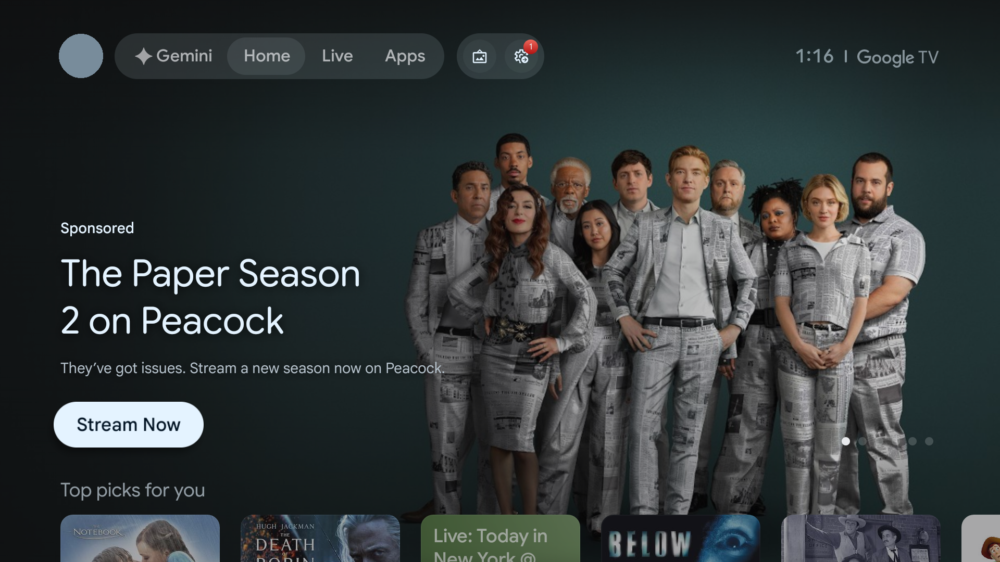
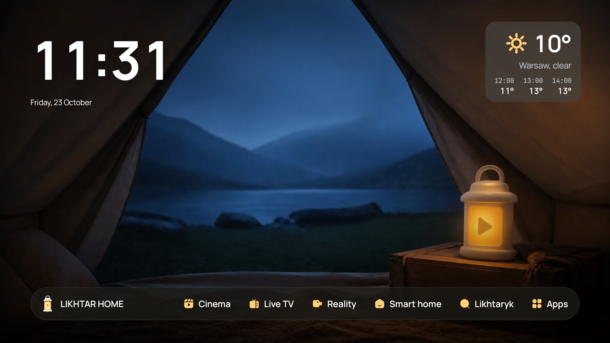
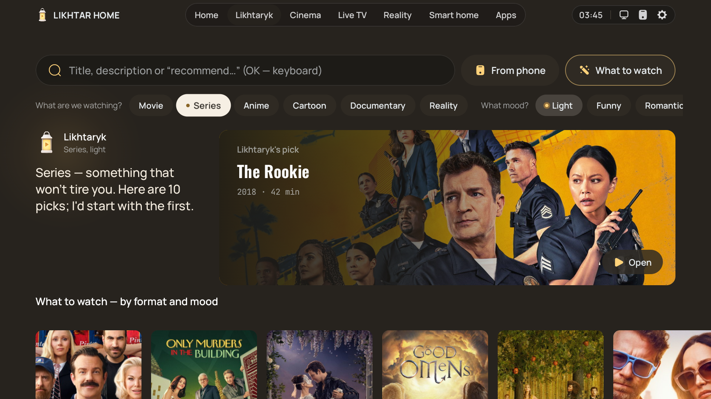
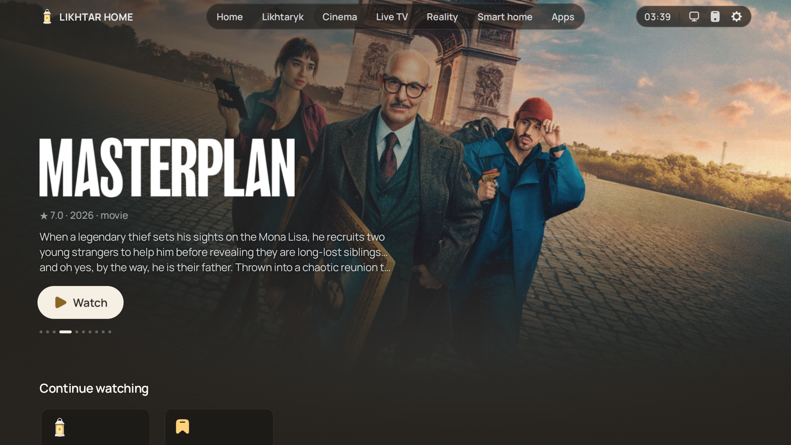
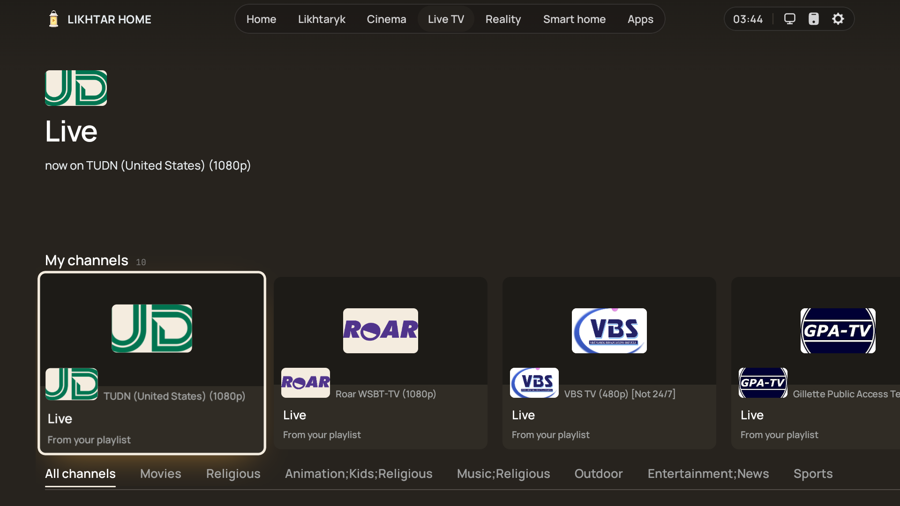
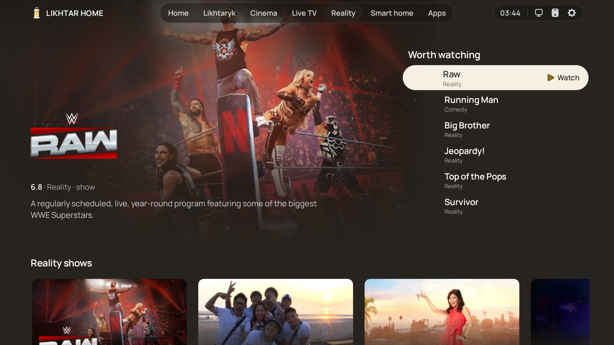
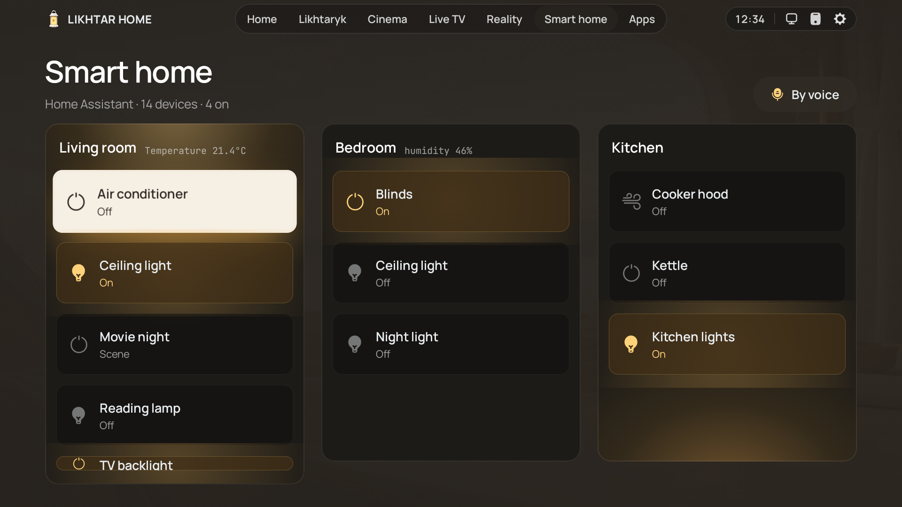
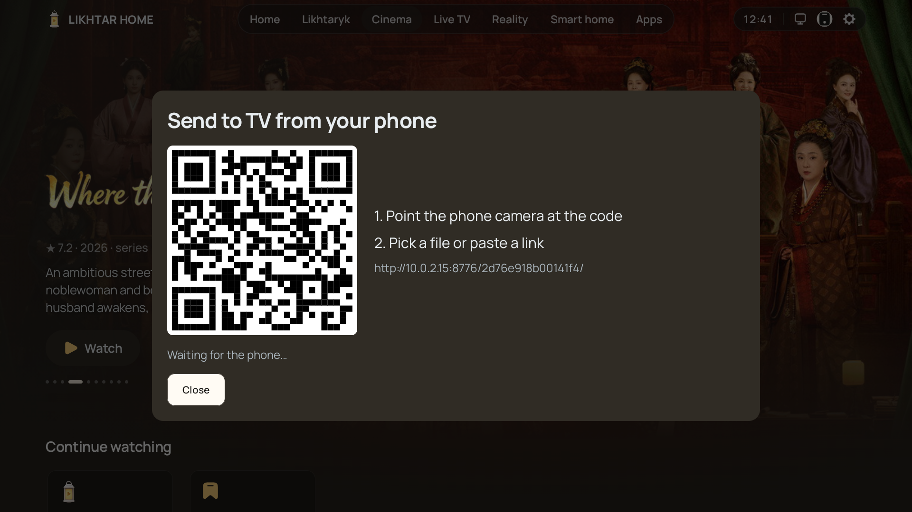
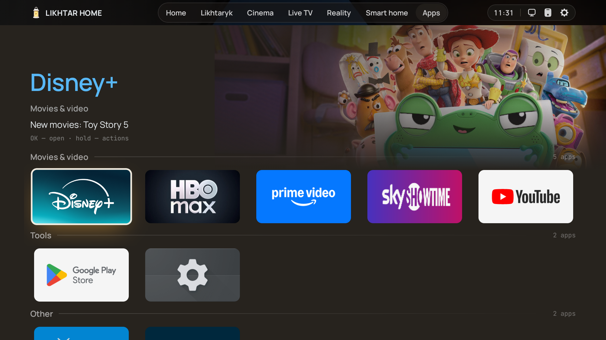
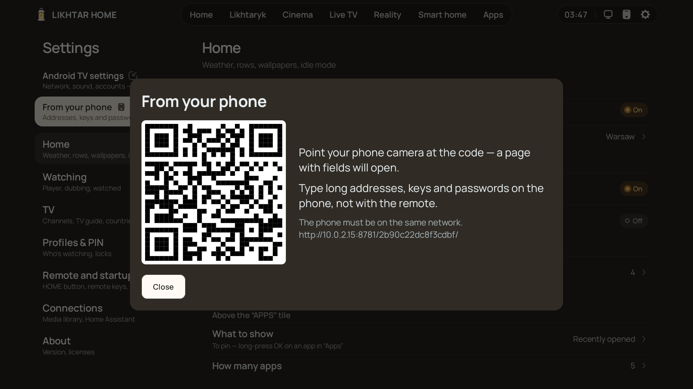

<div align="center">

[English](README.md) · **Українська**

# Likhtar Home

**Ваш телевізор. Без реклами й зайвого шуму.**

Домашній екран для Android TV і Google TV, що відповідає на одне питання — *що дивимось сьогодні?*
Увімкнули телевізор, обрали настрій, натиснули OK.

| Стоковий Google TV | Likhtar Home |
|:---:|:---:|
|  |  |
| *Спонсорський банер і ряди, обрані за вас* | *Ваші шпалери, годинник і розділи в доці* |

`Android TV / Google TV` · `Android 7.0+` · `6.4 МБ` · `GPL-3.0`

**Без реклами · без стеження · без акаунта · без root · без комп'ютера · повернення однією кнопкою**

</div>

| Хочете… | Зробіть так |
|---|---|
| Просто спробувати | [Встановіть APK](#встановлення) й відкрийте як звичайний застосунок. На телевізорі нічого не зміниться. |
| Зробити його домашнім екраном | Натисніть у застосунку *Зробити Likhtar домашнім екраном*. Одне підтвердження на телевізорі, без комп'ютера. |
| Повернути стоковий | *Налаштування → Пульт і запуск → Повернути стоковий домашній екран.* Одна кнопка. |
| Шукати фільми своїми словами | Підключіть свій AI з телефона (за бажанням) — у будь-якій країні, без акаунта Google. |

---

## Навіщо ще один лаунчер?

Стокові домашні екрани телевізорів — це вітрини. Їх зроблено, щоб продати вам наступну підписку,
тож те, чого ви насправді хочете, — *щось добре подивитися просто зараз*, — ховається під
рекламою, трейлерами, що грають самі, і рядами, яких ви не просили.

*Likhtar* — це «ліхтар». Ідея проста: тепле, тихе світло в кутку вітальні, яке показує дорогу до
фільму на вечір і не заважає.

- **Спершу пульт.** Кожен екран зроблено для хрестовини пульта з дивана, за три метри. Фокус не
  губиться, ряди не стрибають, довге натискання працює навіть на пультах, що не шлють повторів.
- **Спокій за замовчуванням.** Теплий графіт і бурштин, великий шрифт, жодного шуму, що грає сам.
  Шпалери й годинник — це і є домашній екран; усе інше — за одне натискання.
- **Відкриває там, де воно живе.** Фільми Netflix — у Netflix, YouTube — у YouTube, ваші канали — у
  вашому плеєрі. Likhtar — це мапа, а не ще один закритий сад; піратських потоків він не грає й не
  тримає.

## Коротка екскурсія

| | |
|---|---|
|  | **Ліхтарик — порадник.** Оберіть формат (фільм, серіал, аніме, мультфільм, документалка, реаліті) і настрій (легке, смішне, напружене, таємниче, романтичне, розумне…) — і отримайте добірку фільмів і серіалів на вечір, без того, що ви вже бачили. |
|  | **Кінозал.** Новинки й тренди на весь екран, далі ряди популярних фільмів і серіалів у вашій країні, жанри й сторінка кожного стрімінгу — з тим, що там щойно з'явилось. |
|  | **Сторінки тайтлів, що допомагають вирішити.** Де дивитися, серії з кадрами, трейлери, актори, схоже й уся франшиза по порядку. Вкладки перемикаються самі, щойно ви на них стаєте. |
|  | **ТВ Ефір з вашого плейлиста.** Один раз вставте M3U і XMLTV свого провайдера (з телефона) — і маєте сітку каналів із логотипами, групами й тим, що йде зараз. |
|  | **Реаліті.** Шоу, про які всі говорять, на одній полиці, а не в п'яти різних застосунках. |
|  | **Розумний дім — з дивана.** Кімнати й пристрої вашого Home Assistant на великому екрані: світло, жалюзі, кондиціонер, чайник, сцени на кшталт *Кіновечора*. Перемикайте пультом або просто скажіть, чого хочете, — запит іде у ваш власний Assist. |
|  | **Передайте що завгодно з телефона.** Скануєте QR — і кидаєте на телевізор відео, фото, APK чи посилання: без застосунку, кабелю й хмари. Навіть повнометражний фільм лягає просто в «Завантаження» телевізора й відкривається потрібним плеєром чи встановлювачем. |
|  | **Ваші застосунки — вже розкладені.** Групи складаються самі, а що нового в кожному сервісі — видно просто на плитці. Будь-який застосунок можна сховати, закріпити чи закрити PIN-кодом. |
|  | **Налаштування з телефона.** Скануєте QR і набираєте довгі адреси, ключі й паролі на телефоні, а не шукаєте літери пультом. |

Ще всередині: **медіатека** для ваших серверів **Jellyfin** і **Plex** («Продовжити» й позначки
«переглянуто» синхронізуються в обидва боки), DLNA-серверів і SMB-папок, погода на Головній, шпалери в
режимі спокою, профілі з PIN-кодами й перепризначення кнопок пульта.

## Свій AI (за бажанням)

Підключіть модель AI і просто скажіть, чого хочеться: *«щось як Інтерстеллар, але легше»*,
*«затишний серіал на дощові вихідні»*, *«що подивитися із семирічною дитиною»*. Ліхтарик відповість
вибором, реченням про те, чому саме він, і рядом альтернатив.

**AI-порадник, що працює в будь-якій країні, без акаунта Google і на моделі, яку обрали ви**, —
вашою мовою, на будь-якому телевізорі чи приставці з Android TV, а не лише на найновіших телевізорах кількох ринків.

- **Ваш ключ — ваша модель.** Свій ключ API для **Anthropic Claude, OpenAI, Google Gemini чи
  OpenRouter** — або модель на вашому власному комп'ютері (**Ollama, LM Studio**): безкоштовно й
  повністю приватно.
- **Набирається на телефоні**, потрапляє на телевізор через QR і зберігається там зашифрованим
  ключем з Android Keystore, який не залишає пристрій.
- **Просто до провайдера.** Запит іде з телевізора до вибраного AI-сервісу. Сервер Likhtar його не
  отримує.
- **Перевіряємо кожну назву.** Кожну пораду звіряємо з TMDB за назвою й роком, перш ніж показати,
  тож вигаданий моделлю фільм до екрана не дійде.
- **Переказ сезону.** Перед третім сезоном попросіть коротко переказати другий — за описами серій,
  без спойлерів далі, ніж ви вже бачили.

Без підключеного AI Ліхтарик однаково працює: поради за форматом і настроєм беруться з готових
карток, а пошук іде через TMDB.

## Приватність простими словами

- Ваша історія, списки, профілі, PIN-коди й налаштування лишаються на телевізорі.
- Ключі, токени, паролі й адреси плейлистів зберігаються зашифрованими.
- Дані про фільми йдуть із TMDB через невеликий шлюз Likhtar лише для читання, тож ключ API
  вставляти не треба. Як і будь-який сайт, він бачить вашу IP-адресу, назви й пошукові запити — але
  не вашу історію, списки, налаштування чи будь-що, що ви питаєте в AI. Звичайних запитів не записує.
- Подробиці: [docs/privacy-policy.md](docs/privacy-policy.md).

## Безпечно спробувати, легко повернути

Стати домашнім екраном на Google TV — найстрашніша частина, тож ось що саме відбувається.

- **Нічого не видаляється.** Likhtar призначає себе домашнім екраном і *вимикає* — не видаляє —
  стоковий лаунчер Google TV та його майстер налаштування. Більше нічого не чіпає.
- **Говорить з телевізором, а не з інтернетом.** Перемикання йде через власне налагодження
  телевізора (`127.0.0.1`), тож ні комп'ютер, ні кабель не потрібні. Ви один раз підтверджуєте це на
  екрані.
- **Спершу перевіряє Wi-Fi.** Якщо збережену мережу записав застосунок, який треба вимкнути, Likhtar
  відмовиться продовжувати: вимкнення могло б стерти вашу мережу.
- **Одна кнопка назад.** *Налаштування → Пульт і запуск → Повернути стоковий домашній екран* вмикає
  все назад у зворотному порядку.
- **Запобіжник від падінь.** Якщо Likhtar упаде тричі за п'ять хвилин, він сам віддасть домашній
  екран стоковому лаунчеру.

> ⚠️ **Перш ніж видаляти Likhtar, натисніть *Повернути стоковий домашній екран*.** Якщо забули —
> поверніть його з комп'ютера:
> ```bash
> adb shell pm enable com.google.android.tungsten.setupwraith
> adb shell pm enable com.google.android.apps.tv.launcherx
> ```

## Як воно росло

Likhtar виходить, коли всі говорять про те, як звільнити свій телевізор, — але почався він не з
цього й не як лаунчер. Він ріс по одній незручності за раз, на справжньому телевізорі у справжній вітальні.

| Коли | Що сталося |
|---|---|
| **Січ 2026** | *Studios Master*: невеликий плагін для медіазастосунку Lampa, що збирав добірки TMDB від великих студій і стрімінгів у його бічне меню. Лише метадані, близько 400 рядків JavaScript. |
| **Бер 2026** | З'являється *Likhtar* — власна головна сторінка для того застосунку з банером, логотипами назв і мітками, з наголосом на україномовному. |
| **5 серп 2026** | У плагіні народжується *Ліхтарик*, помічник із вибору фільму, — спершу на локальній моделі на домашньому комп'ютері. |
| **11 серп 2026** | Плагін упирається в межі чужого застосунку. Перший коміт нативного лаунчера для Android TV на Kotlin і Compose. |
| **12 серп 2026** | ТВ Ефір зі справжньою сіткою каналів і телепрограмою та Кінозал на каталозі TMDB. |
| **Вер 2026** | Розділ «Реаліті», сторінки тайтлів із серіями й франшизами, система фокуса для пульта, переписана з нуля. Ліхтарик стає окремою сторінкою. |
| **20 жовт 2026** | Публічна збірка, якій не потрібен власний домашній сервер, і налаштування з телефона через QR. |
| **23 жовт 2026** | Свій AI, зашифровані секрети й цей README. |

Звідки все почалося, досі відкрито: [перший плагін на GitHub](https://github.com/Syvyj/studios_4lampa).
Цей репозиторій починається з першого публічного випуску лаунчера.

## Встановлення

1. Завантажте найновіший APK з [**Releases**](https://github.com/Syvyj/likhtar-home/releases/latest).
2. Встановіть його на телевізор — застосунком *Downloader*, з флешки або командою
   `adb install likhtar-home.apk`.
3. Відкрийте Likhtar Home і виконайте підказку, щоб зробити його домашнім екраном. Google TV
   дуже тримається за свій лаунчер, тож Likhtar проведе вас через одноразове налаштування просто на
   телевізорі — без комп'ютера.

Працює на телевізорах із вбудованим Android TV чи Google TV і на приставках — на всьому, що працює
на Android TV або Google TV, від Android 7.0. Інтерфейс розкладено під 1080p, і він
масштабується на 720p і 4K.

## Часті питання

**Це безкоштовно?** Так, і код відкритий за GPL-3.0. Без реклами, підписок і платних версій.

**Чи потрібен сервер або комп'ютер?** Ні. Публічна збірка працює сама; дані про фільми йдуть через
невеликий шлюз лише для читання. Комп'ютер знадобиться, тільки якщо хочете встановлювати через `adb`.

**Він сам грає фільми?** Ні. Likhtar показує, що є і де, а тоді відкриває офіційний застосунок —
Netflix, Disney+, YouTube, плеєр вашого провайдера. ТВ Ефір грає плейлист, який додали *ви*.

**Чи потрібна підписка на AI?** Ні. Поради за настроєм, пошук і всі розділи працюють без AI.
Підключена модель лише додає запити своїми словами й переказ сезонів — а локальна модель нічого не
коштує.

**Оновлення Google TV його зламають?** Оновлення системи може знову ввімкнути стоковий лаунчер. На
наступному запуску Likhtar тихо поверне собі домашній екран — якщо налагодження по USB досі
ввімкнене. Ваших налаштувань це не торкається.

**Налагодження по USB треба лишати ввімкненим?** Лише якщо хочете цього автоматичного повернення після
оновлень. Вимкнете — Likhtar лишиться домашнім екраном, а після оновлення доведеться ще раз натиснути
*Зробити домашнім* (Налаштування → Пульт і запуск).

**Якими мовами?** Інтерфейс іде за мовою телевізора: англійська, українська чи польська.

## Перевірено на

| Пристрій | Android | Стан |
|---|---|---|
| Приставка Skyworth / RockTek з Google TV (4K) | 14 | Щоденно з серпня 2026 |
| Емулятор Google TV з Android Studio | 14 | На кожному випуску |

Спробували на іншому телевізорі чи приставці? Відкрийте issue з моделлю і тим, що спрацювало, —
список росте разом із вами.

## Збирання з коду

Потрібні: Android Studio (остання стабільна), JDK 17.

```bash
./gradlew assemblePlayDebug        # публічна збірка, debug
./gradlew assemblePlayRelease      # публічна збірка, release
./gradlew testPlayDebugUnitTest lintPlayRelease
```

За бажанням, у локальному `.env` (ніколи не комітиться):

```properties
TMDB_key=your-tmdb-api-key            # ходити в TMDB напряму, а не через шлюз
LIKHTAR_KEYSTORE=/path/to/release.jks # підписувати release своїм ключем
LIKHTAR_KEYSTORE_PASSWORD=…
LIKHTAR_KEY_ALIAS=…
LIKHTAR_KEY_PASSWORD=…
```

Проєкт поділено на `app`, `core/*` (дизайн-система, дані, каталог, ТВ, розумний дім, шпалери) і
`feature/*` (по модулю на екран).

## Підтримка

Likhtar безкоштовний і таким лишиться. Якщо він зробив ваші вечори трохи простішими, можна
підтримати: [Ko-fi](https://ko-fi.com/syvyj) · [Buy Me a Coffee](https://buymeacoffee.com/syvyj) ·
[банка Monobank](https://send.monobank.ua/jar/5juJPj142b). Ті самі посилання є на
[сайті](https://likhtar.syvyj.dev/uk/#support) і, як QR-код, у *Налаштування → Про застосунок →
Підтримати автора*.

## Подяки

- Дані й зображення фільмів і серіалів: [TMDB](https://www.themoviedb.org). This product uses the
  TMDB API but is not endorsed or certified by TMDB. Дані «де дивитися»: JustWatch, через TMDB.
- Погода: [Open-Meteo](https://open-meteo.com) (CC BY 4.0).
- Клієнт ADB на самому телевізорі, що робить Likhtar домашнім екраном, перенесено з
  [Free My TV](https://github.com/simbasjungles/free-my-tv) (MIT).
- Шрифти: Manrope, JetBrains Mono, Oswald (SIL OFL 1.1).
- Кожен сторонній компонент і його ліцензію перелічено в застосунку — *Налаштування → Про
  застосунок* — і в [NOTICE.md](NOTICE.md).

## Ліцензія

Likhtar Home — вільна програма за [GNU General Public License v3.0](LICENSE).
Зроблено в Україні — для віталень усього світу.
