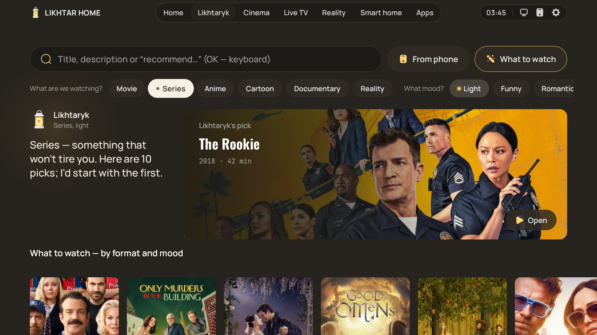
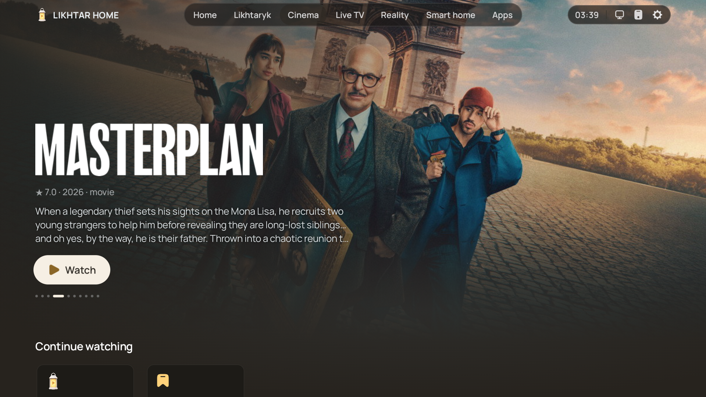
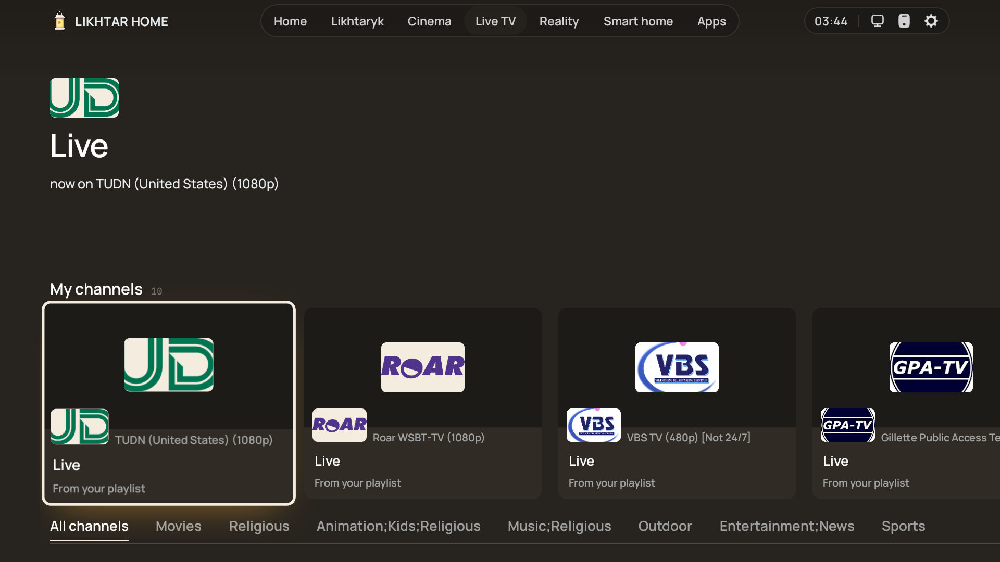
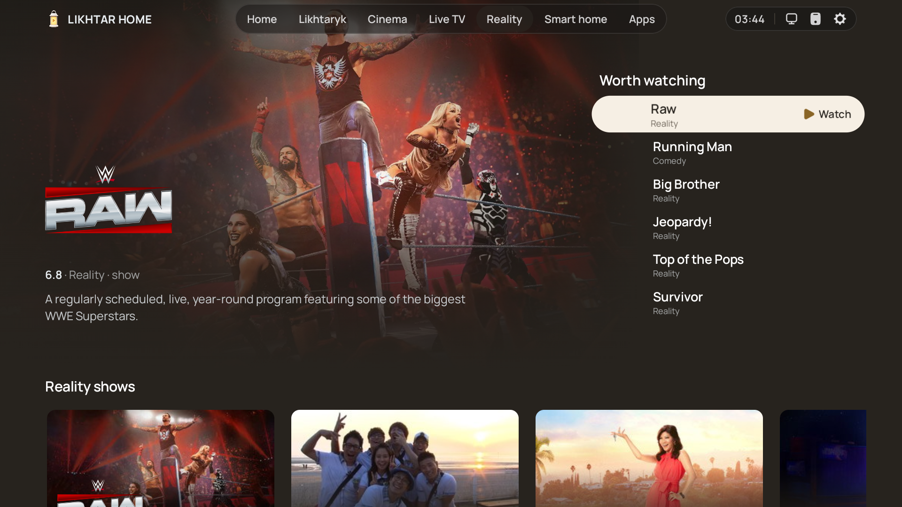
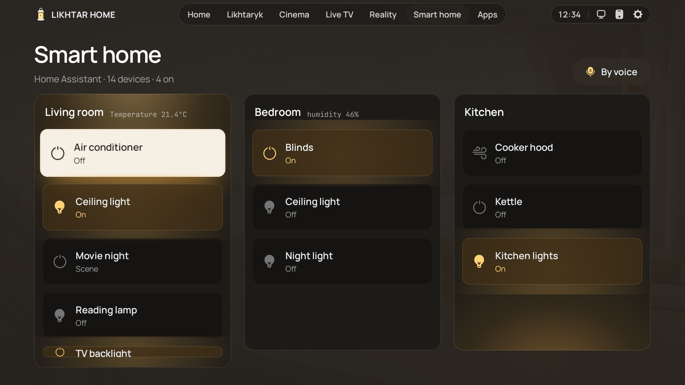
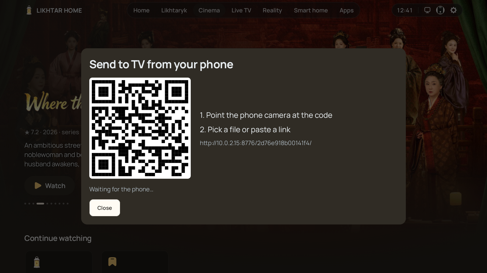
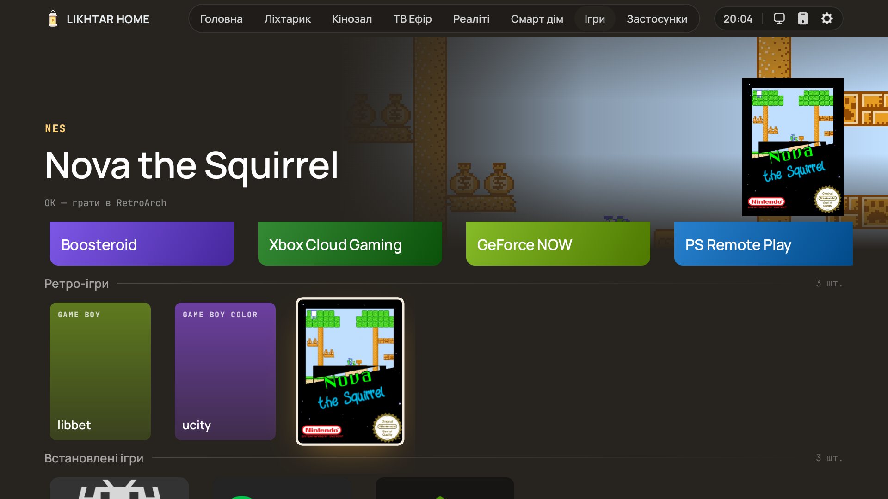
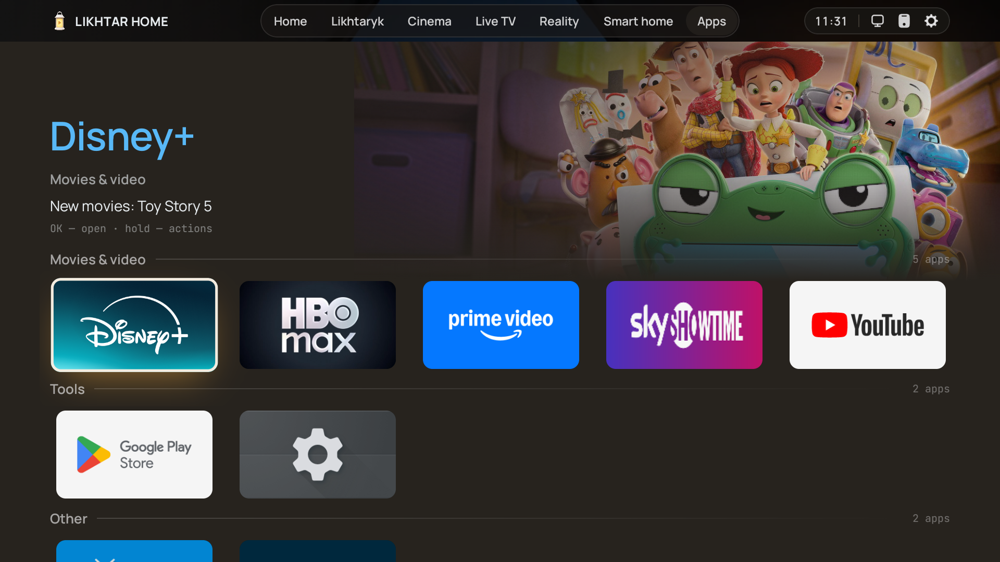
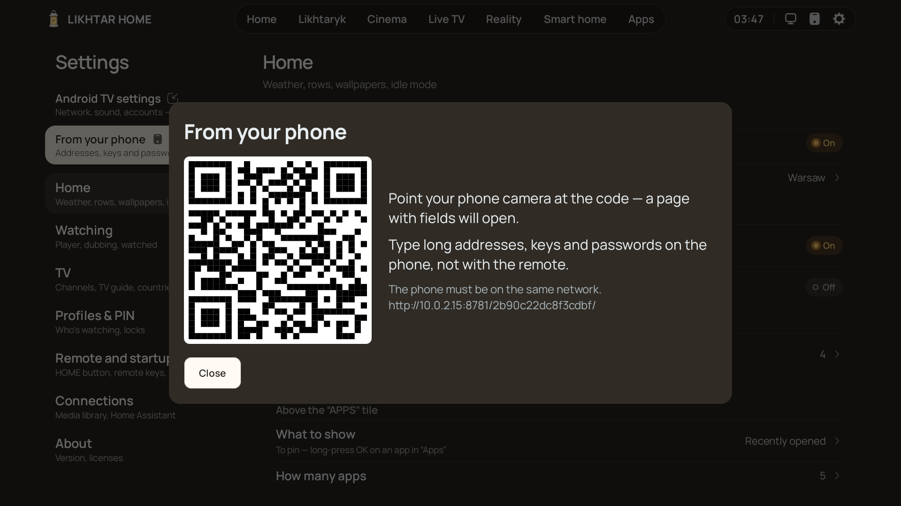

# Likhtar Home

## Why Likhtar?

Stock TV home screens are storefronts. They are built to sell you the next subscription, so the
thing you actually want — *something good to watch, right now* — is buried under ads, autoplaying
trailers and rows you never asked for. *Likhtar* means "lantern" in Ukrainian: a warm, quiet light in
the corner of the living room that shows you the way to tonight's film and then gets out of the way.
It is not just another grid of app icons.

### A calm home screen

Your wallpaper, the clock and your sections in the dock; everything else is one press away. Warm
graphite and amber, big type, no autoplay noise. Every screen is built for a D‑pad from the sofa:
focus never gets lost, rows never jump.

### Something to watch tonight

**Likhtaryk** picks films and series by format and mood, skipping what you've already seen.
**Cinema** shows what's new in your country and a page for every streaming service. A title opens
where it lives — Netflix in Netflix, YouTube in YouTube — and Likhtar never plays or hosts pirated
streams. Want to ask in your own words? [Connect your own AI](../README.md#ai-on-your-terms-optional), if you like.

### Set up your TV from your phone

A small Android app finds the TV on your Wi‑Fi and installs Likhtar, no computer or USB stick. After
that, scan a QR code to reorder sections, choose which Cinema rows and streaming services show,
type passwords and playlist addresses, and send files. Nothing is typed with the remote.

### Everything else in one place

Your **Jellyfin** and **Plex** libraries with *Continue watching* synced both ways, **Live TV** from your
own M3U playlist with a programme guide, **Home Assistant** rooms by remote or voice, **games** from
the cloud and your own ROMs, and your apps sorted for you.

## See it in action

| | |
|---|---|
|  | **Likhtaryk — the advisor.** Choose a format (film, series, anime, cartoon, documentary, reality) and a mood (light, funny, tense, mysterious, romantic, smart…) and get a selection of films and series for tonight — skipping what you've already watched. |
|  | **Cinema.** A full-screen spotlight on what's new and trending, then rows of popular films and series for your country, genres, and a page for every streaming service — with what just landed there. |
|  | **Title pages that help you decide.** Where to watch it, episodes with stills, trailers, cast, similar titles and the whole franchise in order. Tabs switch as you move — no extra clicks. |
|  | **Live TV from your own playlist.** Paste your provider's M3U and XMLTV once (from your phone), get a channel grid with logos, groups and what's on now. |
|  | **Reality.** The shows everyone talks about, gathered in one shelf instead of scattered across five apps. |
|  | **Smart home, from the sofa.** Your Home Assistant rooms and devices on the big screen: lights, blinds, the air conditioner, the kettle, scenes like *Movie night*. Toggle them with the remote, or just say what you want — the request goes to your own Home Assistant Assist. |
|  | **Send anything from your phone.** Scan the QR code and drop a video, a photo, an APK or a link onto the TV — no app, no cable, no cloud. Even a full-length film goes straight to the TV's Downloads and opens in the right player or installer. |
|  | **Games, in their own section.** Cloud gaming (Boosteroid, Xbox Cloud Gaming, GeForce NOW, PS Remote Play) in one press, and your own ROMs with box art, started in RetroArch with no menus. Off by default; details in [games.md](games.md). |
|  | **Your apps, sorted for you.** Grouped automatically, with what's new inside each service shown right on the tile. Hide, pin or lock any app with a PIN. |
|  | **Settings from your phone.** Scan a QR code: type passwords and addresses on the phone, reorder sections, choose Cinema rows and streaming services, paste text into the TV's clipboard. |

Also inside: a **media library** for your **Jellyfin** and **Plex** servers (Continue watching and
watched marks stay in sync both ways), DLNA servers and SMB shares, weather on the home
screen, idle-mode wallpapers, profiles with PIN locks, and remote-key remapping.

