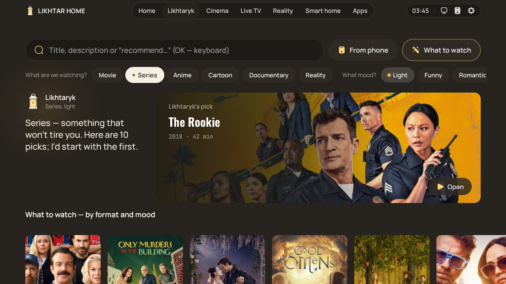
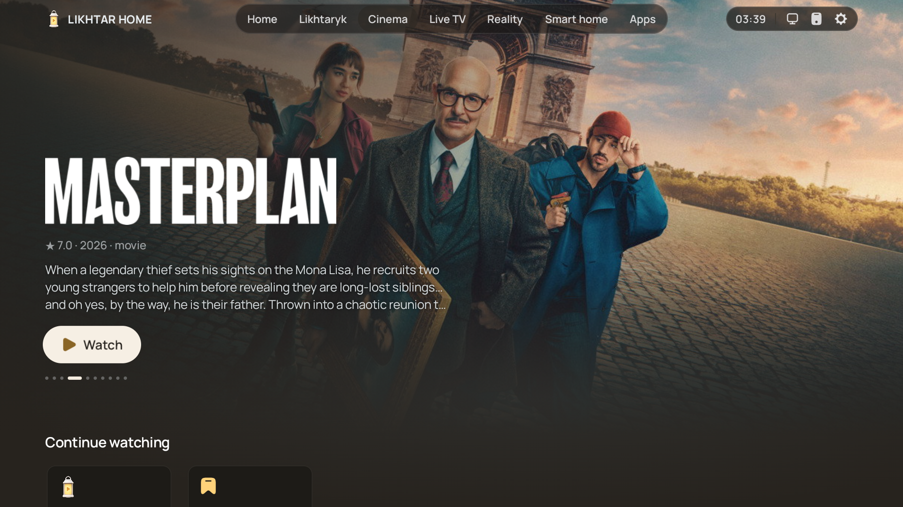
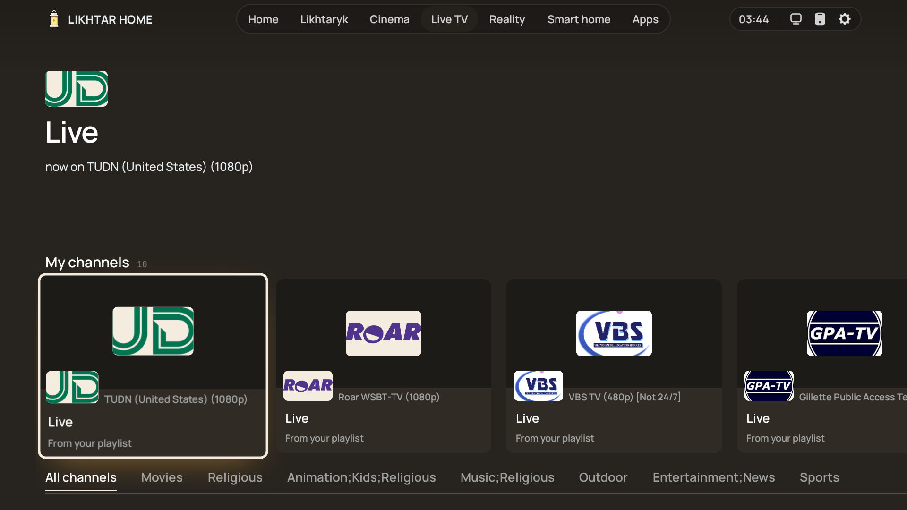
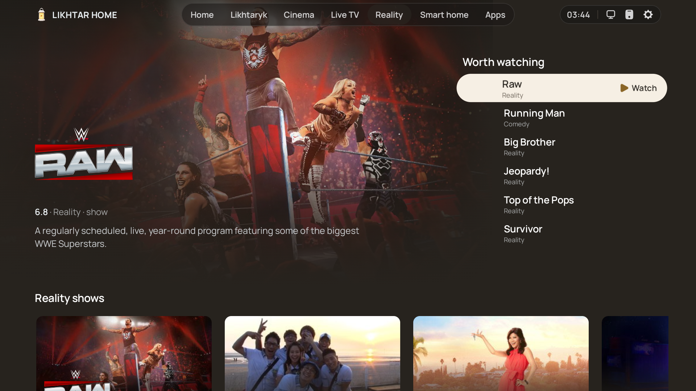
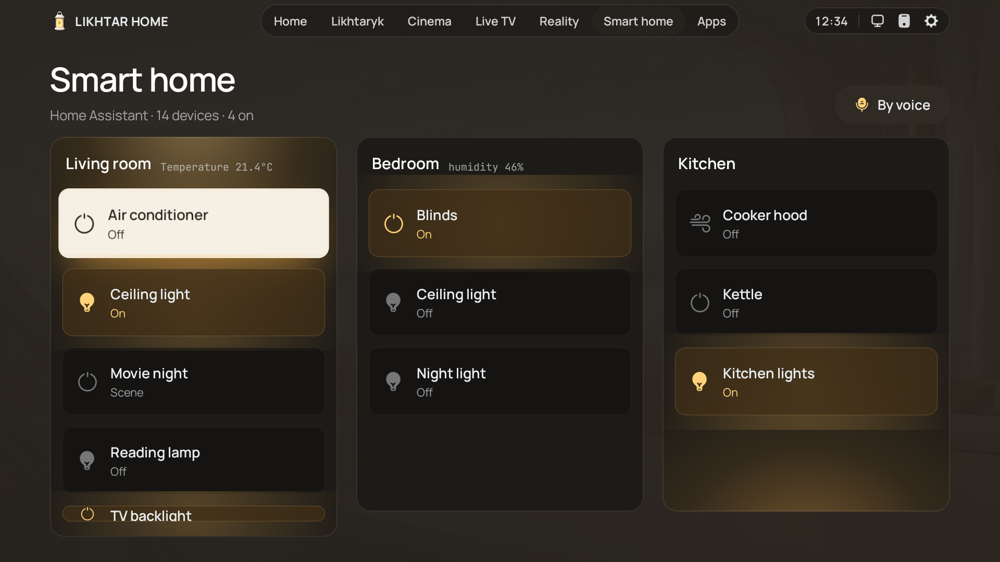
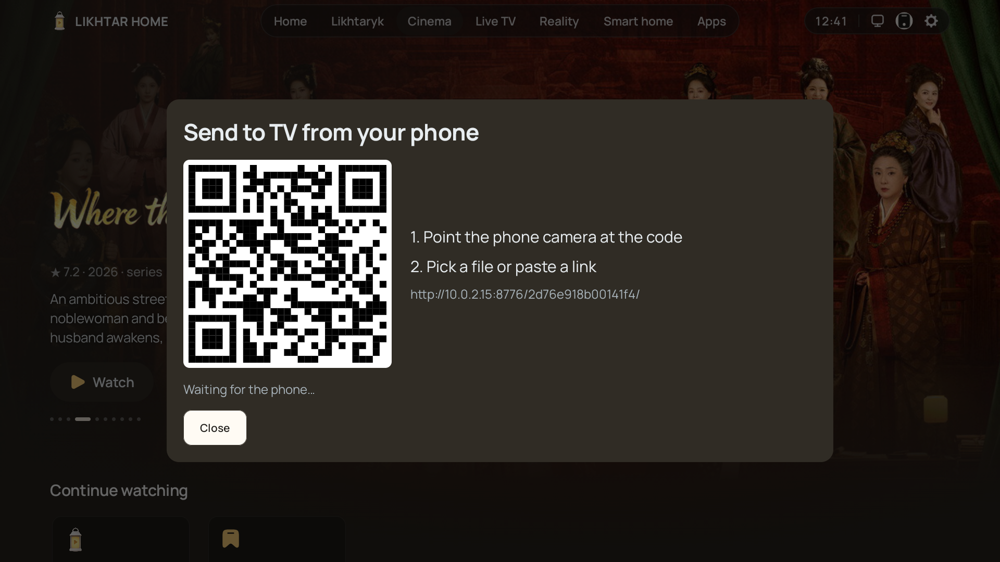
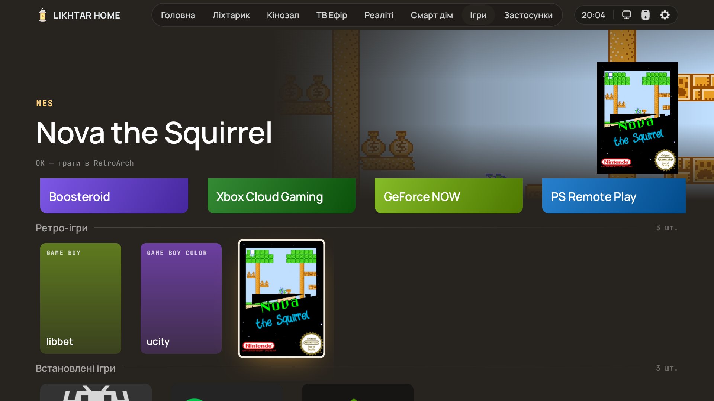
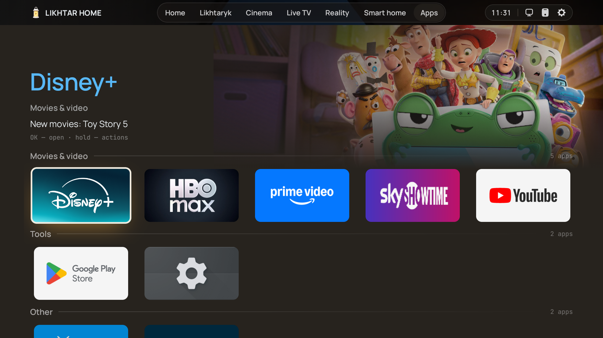
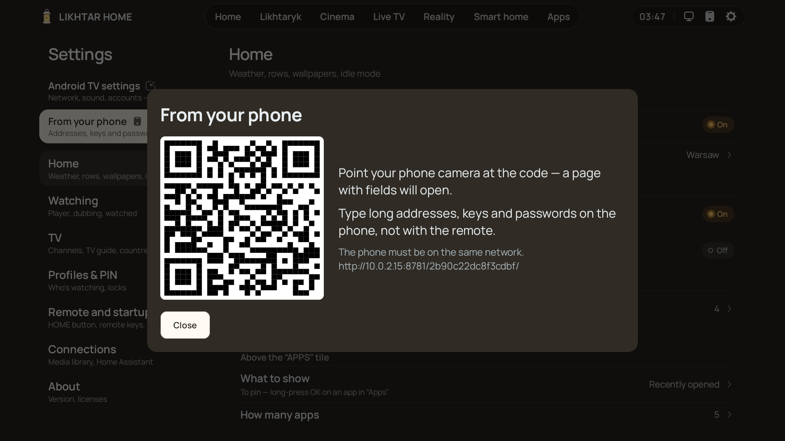

# Likhtar Home

## Чому Ліхтар?

Стокові домашні екрани телевізорів — це вітрини. Їх зроблено, щоб продати вам наступну підписку,
тож те, чого ви насправді хочете, — *щось добре подивитися просто зараз*, — ховається під
рекламою, трейлерами, що грають самі, і рядами, яких ви не просили. *Likhtar* — це «ліхтар»: тепле,
тихе світло в кутку вітальні, яке показує дорогу до фільму на вечір і не заважає. Це не просто
ще одна сітка значків.

### Спокійний домашній екран

Ваші шпалери, годинник і розділи в доці; усе інше — за одне натискання. Теплий графіт і бурштин,
великий шрифт, нічого не грає саме. Кожен екран зроблено для пульта з дивана: фокус не губиться,
ряди не стрибають.

### Що подивитися сьогодні

**Ліхтарик** добирає фільми й серіали за форматом і настроєм, без уже переглянутого. **Кінозал**
показує новинки у вашій країні й сторінку кожного стрімінгу. Фільм відкривається там, де він живе:
Netflix — у Netflix, YouTube — у YouTube, а піратських потоків Likhtar не грає й не тримає. Хочете
питати своїми словами? [Підключіть свій AI](../README.uk.md#свій-ai-за-бажанням).

### Налаштування з телефона

Невеликий застосунок для Android сам знаходить телевізор у Wi‑Fi і ставить Ліхтар, без
комп'ютера й флешки. А далі QR-код: переставляєте розділи, вибираєте ряди Кінозалу й стрімінги,
набираєте паролі й адреси плейлистів, передаєте файли. Пультом нічого не набирати.

### Усе інше — в одному місці

Ваші **Jellyfin** і **Plex** із «Продовжити», що синхронізується в обидва боки, **ТВ Ефір** з вашого
M3U-плейлиста з телепрограмою, кімнати **Home Assistant** пультом чи голосом, **ігри** з хмари й
ваші власні, і застосунки, розкладені самі.

## Як це виглядає

| | |
|---|---|
|  | **Ліхтарик — порадник.** Оберіть формат (фільм, серіал, аніме, мультфільм, документалка, реаліті) і настрій (легке, смішне, напружене, таємниче, романтичне, розумне…) — і отримайте добірку фільмів і серіалів на вечір, без того, що ви вже бачили. |
|  | **Кінозал.** Новинки й тренди на весь екран, далі ряди популярних фільмів і серіалів у вашій країні, жанри й сторінка кожного стрімінгу — з тим, що там щойно з'явилось. |
|  | **Сторінки тайтлів, що допомагають вирішити.** Де дивитися, серії з кадрами, трейлери, актори, схоже й уся франшиза по порядку. Вкладки перемикаються самі, щойно ви на них стаєте. |
|  | **ТВ Ефір з вашого плейлиста.** Один раз вставте M3U і XMLTV свого провайдера (з телефона) — і маєте сітку каналів із логотипами, групами й тим, що йде зараз. |
|  | **Реаліті.** Шоу, про які всі говорять, на одній полиці, а не в п'яти різних застосунках. |
|  | **Розумний дім — з дивана.** Кімнати й пристрої вашого Home Assistant на великому екрані: світло, жалюзі, кондиціонер, чайник, сцени на кшталт *Кіновечора*. Перемикайте пультом або просто скажіть, чого хочете, — запит іде у ваш власний Assist. |
|  | **Передайте що завгодно з телефона.** Скануєте QR — і кидаєте на телевізор відео, фото, APK чи посилання: без застосунку, кабелю й хмари. Навіть повнометражний фільм лягає просто в «Завантаження» телевізора й відкривається потрібним плеєром чи встановлювачем. |
|  | **Ігри — окремим розділом.** Хмарні ігри (Boosteroid, Xbox Cloud Gaming, GeForce NOW, PS Remote Play) одним OK і ваші власні образи ігор з обкладинками, що запускаються в RetroArch без меню. За замовчуванням вимкнено; подробиці в [games.uk.md](games.uk.md). |
|  | **Ваші застосунки — вже розкладені.** Групи складаються самі, а що нового в кожному сервісі — видно просто на плитці. Будь-який застосунок можна сховати, закріпити чи закрити PIN-кодом. |
|  | **Налаштування з телефона.** Скануєте QR: паролі й адреси набираєте на телефоні, переставляєте розділи, вибираєте ряди Кінозалу й стрімінги, кидаєте текст у буфер обміну телевізора. |

Ще всередині: **медіатека** для ваших серверів **Jellyfin** і **Plex** («Продовжити» й позначки
«переглянуто» синхронізуються в обидва боки), DLNA-серверів і SMB-папок, погода на Головній, шпалери в
режимі спокою, профілі з PIN-кодами й перепризначення кнопок пульта.

